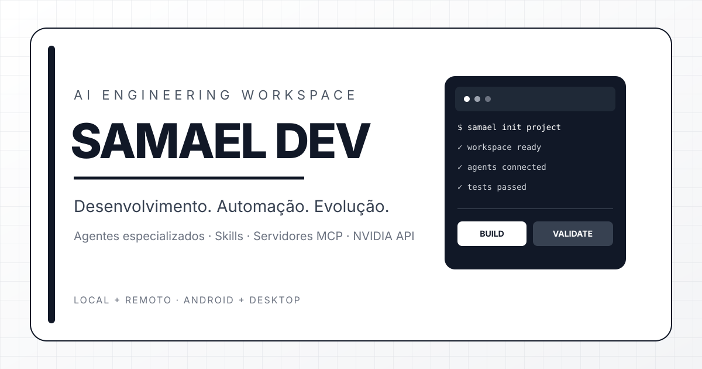
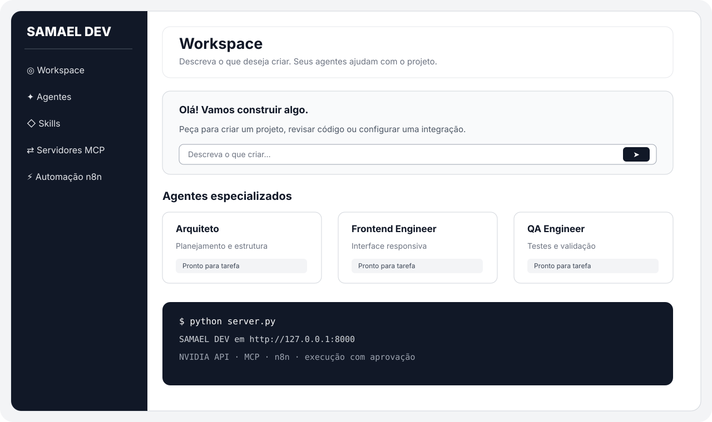

# SAMAEL DEV

Workspace de IA para criar sites, apps e automações. Interface monocromática branca, preta e cinza no navegador + servidor local em Python.

## Prévia da interface

## Como rodar

1. Instale Python 3.9+.
2. Copie `.env.example` para `.env` e configure `NVIDIA_API_KEY` e `NVIDIA_MODEL`.
3. Linux/Termux: `set -a; . ./.env; set +a; python3 server.py`.
4. Abra http://127.0.0.1:8000.
5. Execute os testes com `python3 tests/smoke_test.py`.

Veja as instruções completas e a licença MIT nos arquivos do repositório.